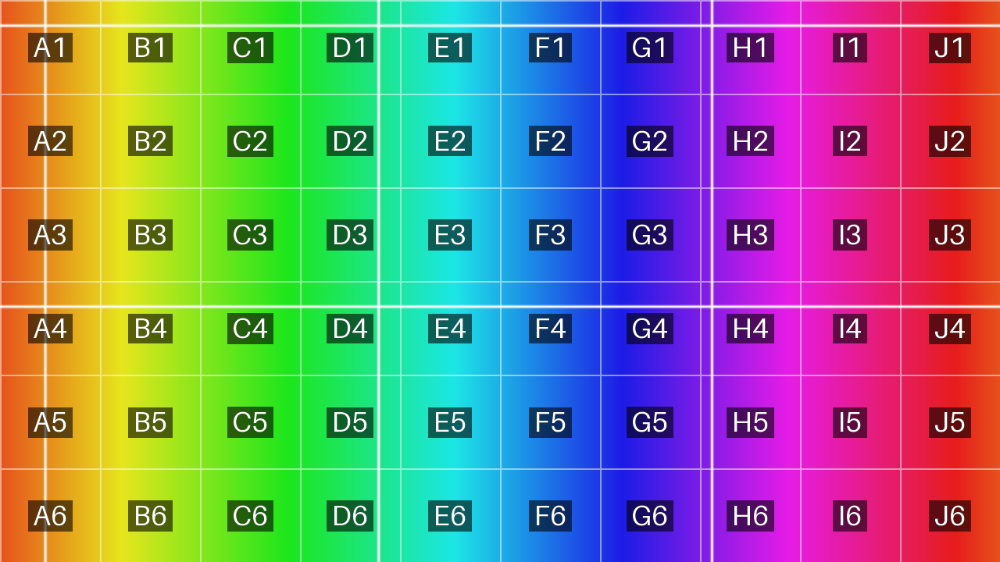

# Projection Test-Pattern Generator

A standalone desktop app for generating **seamless, loopable test patterns** for projection
mapping — a smoothly scrolling colour loop with optional **horizontal/vertical tracking
lines** and **number grids**, exported to any common video format.

No Blender, no dependencies to install for end users: it ships as a single Windows `.exe`.



---

## Why

This project began as a Blender add-on (`BlenderSimpleProjectionColourLoop.py`) that rendered
a scrolling hue gradient through Blender's 3D engine. That works, but it requires a multi-
gigabyte Blender install and a GPU render pipeline for what is fundamentally a **2D pattern**.

This app generates every frame directly with NumPy and encodes with FFmpeg (via PyAV), so it
is small, fast, deterministic, pixel-exact, and can composite overlays with plain code. See
[`IMPLEMENTATION_PLAN.md`](IMPLEMENTATION_PLAN.md) for the full analysis and design.

## Features

- **Seamless colour loop** — the last frame joins cleanly back to the first. Adjustable
  saturation, value, number of hue cycles, axis (horizontal/vertical), and direction.
- **Tracking / scanning lines** — independent horizontal and vertical groups with count,
  thickness, colour, opacity, solid/soft style, and integer sweep speed (so motion stays
  perfectly loopable). Useful for latency, tearing, and edge-alignment checks.
- **Number grid** — labelled cells (alpha-numeric `A1`, sequential, row/col, or pixel
  coordinates) with configurable grid lines, font size, colours, and optional dark label
  pads. Ideal for calling out regions during alignment ("artifact in cell D7").
- **Image / logo overlay** — composite a custom picture onto the pattern with position,
  scale, opacity, and grid-layering (behind / on top) controls, plus optional seamless
  effects — grow & shrink, fade, spin, and a screensaver-style bounce that drifts
  diagonally off the edges — all completing whole cycles per loop so the final frame
  returns to the start. Selecting an effect starts the preview so it plays in action.
- **Any format** — H.264 / H.265 MP4, VP9 WebM, AV1, ProRes 422 HQ MOV, lossless FFV1 MKV,
  or a PNG image sequence. Even-dimension and NTSC frame-rate handling built in.
- **Live preview** with a frame scrubber and play/pause, so you can eyeball seamlessness.
- **Presets** — save/load every setting as a JSON file.
- **GUI and CLI** — a polished PySide6 interface, plus a headless command line for batch jobs.

## Format presets

| Preset key | Format | Codec | Pixel format | Quality |
|---|---|---|---|---|
| `h264_mp4` | MP4 (default) | libx264 | yuv420p | CRF 18 |
| `h265_mp4` | MP4 (smaller) | libx265 | yuv420p | CRF 22 |
| `vp9_webm` | WebM | libvpx-vp9 | yuv420p | CRF 30 |
| `av1_mp4` | MP4 | libsvtav1 | yuv420p | CRF 30 |
| `prores_mov` | MOV (editing) | prores_ks | yuv422p10le | ProRes HQ |
| `ffv1_mkv` | MKV (archival) | ffv1 | yuv444p | lossless |
| `png_sequence` | PNG frames | — | rgb | lossless |

---

## Download / run

Grab `ProjectionTestPatternGenerator.exe` from the
[Releases](../../releases) page and double-click it. Nothing else to install.

## Build the single-file executable

**Requirements:** Python 3.10–3.12. The same `packaging/projgen.spec` builds on both
platforms — PyInstaller cannot cross-compile, so build Windows on Windows and macOS on macOS.

### Windows

```powershell
./packaging/build.ps1
```

That installs the dependencies and runs PyInstaller; the result is
`dist/ProjectionTestPatternGenerator.exe`.

### macOS

```bash
bash packaging/build_mac.sh
```

This produces both `dist/ProjectionTestPatternGenerator` (single-file binary) and
`dist/ProjectionTestPatternGenerator.app` (double-click bundle). The build targets the
machine's own architecture (Apple Silicon or Intel). Because the app is unsigned, the first
launch needs a right-click → **Open**, or clear the quarantine flag:
`xattr -dr com.apple.quarantine dist/ProjectionTestPatternGenerator.app`.

### Manual steps (either platform)

```bash
python -m pip install -e .
python -m pip install pyinstaller
python -m PyInstaller packaging/projgen.spec --clean --noconfirm
```

The FFmpeg libraries are bundled automatically — PyAV ships them and the PyInstaller spec
collects them, so every codec above works in the frozen app with no extra binaries.

The app icon lives at `src/projgen/assets/` (`icon.ico` for Windows and the runtime window,
`icon.icns` for macOS) and is used for both the executable and the application window.
Replace those files to rebrand, then rebuild.

> **Windows icon cache:** after rebuilding, Explorer may still show the previous icon from
> its cache. Copy the exe to a new name, or clear the cache
> (`ie4uinit.exe -show`) to force a refresh.

---

## Run from source

```bash
py -m pip install --user -e .
py -m projgen          # launches the GUI
```

## Command-line usage

Running `projgen` with any argument uses the headless CLI (no window):

```bash
# 10-second 1080p H.264 with 3 horizontal lines and an 8x8 labelled grid
py -m projgen.cli --width 1920 --height 1080 --fps 25 --duration 10 \
    --hlines 3 --grid 8x8 --grid-labels alpha_num -o output/pattern

# lossless archival master
py -m projgen.cli --preset ffv1_mkv --width 3840 --height 2160 -o output/master

# overlay a pulsing logo in the lower-right corner
py -m projgen.cli --image logo.png --image-pos 85,85 --image-scale 15 \
    --image-effect pulse --image-cycles 2 -o output/branded

# render from a saved GUI preset
py -m projgen.cli --config myshow.json -o output/myshow

py -m projgen.cli --list-presets      # show every format
py -m projgen.cli --help              # all options
```

---

## Development

```bash
py -m pip install --user -e ".[dev]"
py -m pytest                          # run the test suite
```

### Project layout

```
src/projgen/
├── core/          # pure, UI-independent engine
│   ├── config.py      # dataclass settings + JSON presets
│   ├── color.py       # vectorised HSV -> RGB
│   ├── pattern.py     # seamless colour-loop frames
│   ├── overlays.py    # tracking lines + number grid
│   ├── render.py      # composes base pattern + overlays
│   └── encoder.py     # PyAV encoding + format presets
├── ui/            # PySide6 GUI (app, preview, worker, theme)
├── cli.py         # headless command line
└── __main__.py    # GUI with no args, CLI with args
packaging/         # PyInstaller spec + build script
tests/             # pytest suite
```

The `core` package never imports Qt, so the engine is fully testable and reusable.

## Licensing note

The frozen executable bundles the FFmpeg libraries that ship with PyAV. Depending on which
FFmpeg build is present (e.g. one linked against GPL components such as x264/x265), the
resulting binary may be subject to the GPL. Check the FFmpeg build's license before
distributing binaries publicly.

## License

MIT — see [`LICENSE`](LICENSE).
